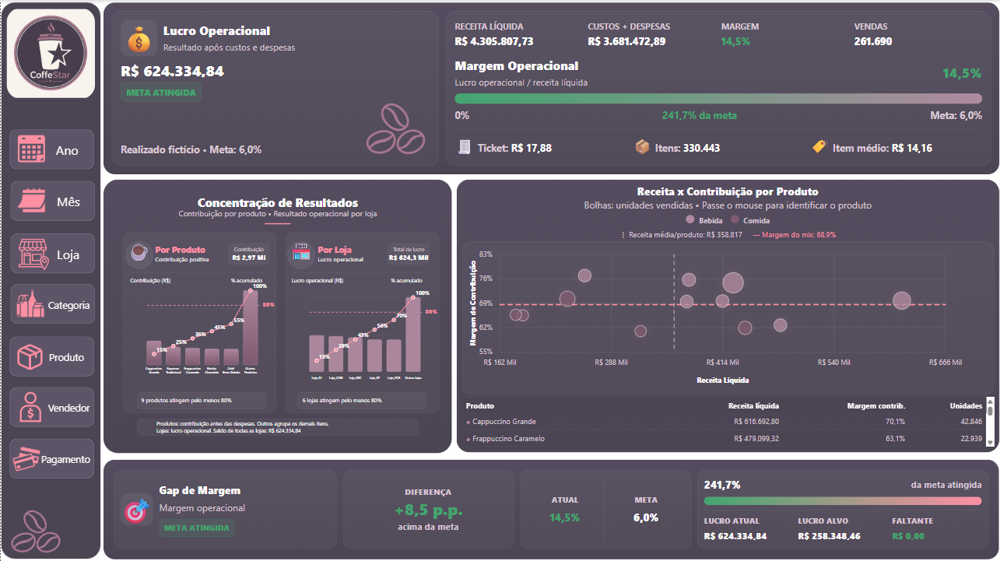
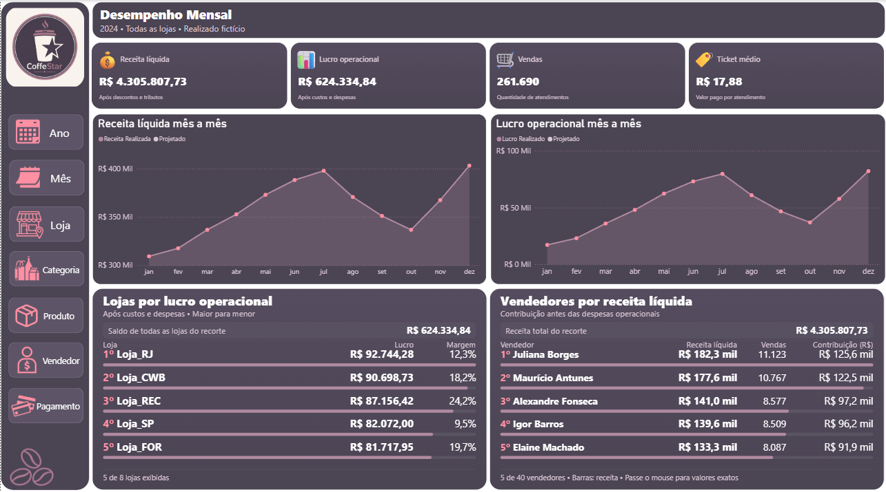
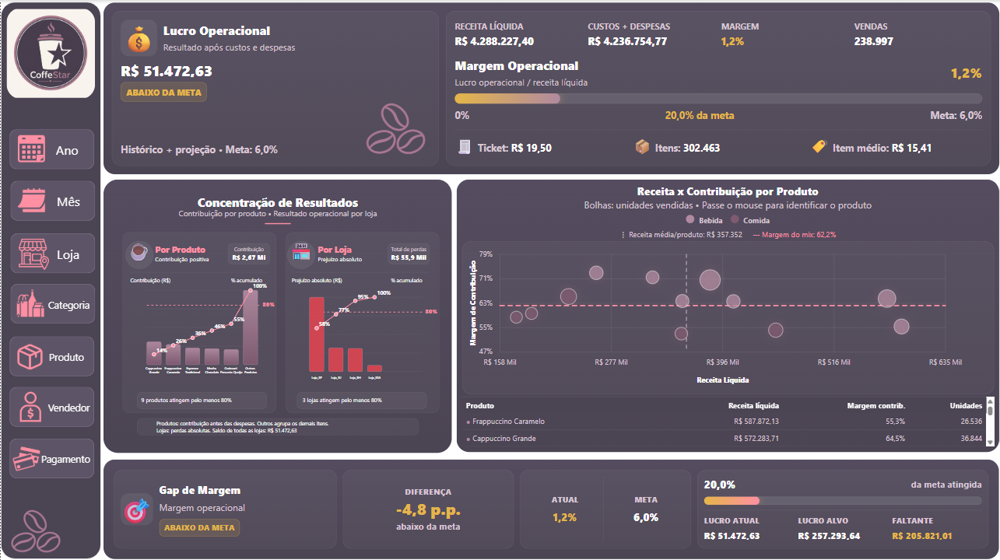
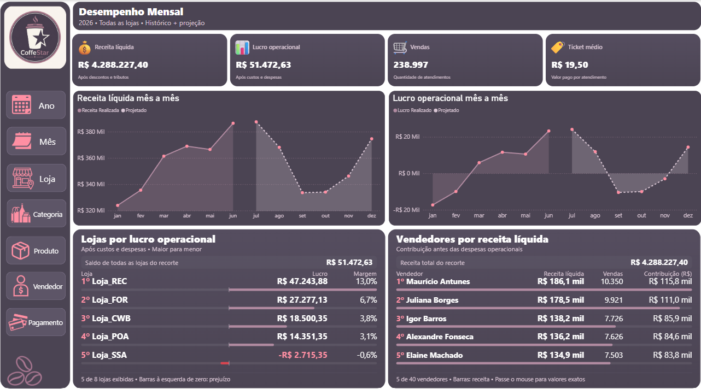
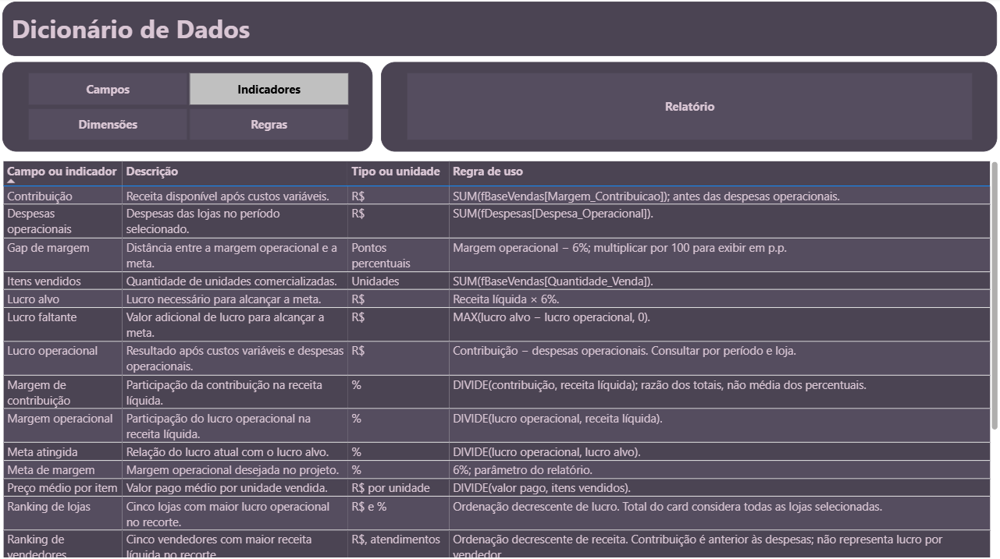

# CoffeStar - Análise de vendas e rentabilidade

Projeto de Business Intelligence de uma rede fictícia de cafeterias, desenvolvido com Power BI, DAX e Excel. O relatório acompanha receita, custos, lucro operacional e desempenho de lojas e vendedores, com histórico simulado e projeção.

**Todos os dados são fictícios e foram preparados para estudo e portfólio.**

## Objetivo

Responder a perguntas de gestão:

- Como a receita e o lucro operacional evoluem mês a mês?
- Quais lojas apresentam os maiores resultados operacionais?
- Quais produtos e vendedores geram mais receita e contribuição?
- A margem operacional alcança a meta de 6%?
- Como o cenário projetado complementa o histórico de 2026?

## Visão Geral

Apresenta receita líquida, custos e despesas, lucro e margem operacional, concentração de resultados e relação entre receita e contribuição por produto. O acompanhamento da meta mostra a distância entre o resultado atual e o lucro necessário para atingir 6% de margem.

## Desempenho Mensal

Reúne indicadores de receita líquida, lucro operacional, atendimentos e ticket médio, além de gráficos mensais e rankings de lojas e vendedores. Os filtros permitem consultar período, loja, categoria, produto, vendedor e forma de pagamento, respeitando as limitações de cada indicador.

As capturas principais usam 2024 e todas as lojas. Nesse recorte, a simulação apresenta receita líquida de **R$ 4.305.807,73**, lucro operacional de **R$ 624.334,84** e margem operacional de **14,5%**.

## Histórico e projeção

- **Realizado fictício:** janeiro de 2020 a junho de 2026.
- **Projetado:** julho a dezembro de 2026.

Os gráficos distinguem os dois cenários. O total anual de 2026 pode combinar o histórico fictício e a projeção; ele não representa um ano inteiramente realizado.

Ver os painéis de 2026

### Visão Geral — 2026

### Desempenho Mensal — 2026

## Dicionário de Dados

Uma página do relatório documenta os campos, indicadores e regras de negócio. Os filtros por grupo e tabela ajudam a consultar significados, unidades e critérios de cálculo.

## Dados e modelagem

A base contempla 8 lojas, 40 vendedores e 12 produtos. O modelo utiliza duas tabelas de fatos:

- **fBaseVendas:** histórico e projeção de vendas.
- **fDespesas:** despesas operacionais por loja e competência.

As dimensões de calendário, lojas e cenário permitem analisar ambas as tabelas de fatos. Produtos e vendedores detalham as vendas. A tabela do dicionário permanece sem relacionamentos com o modelo analítico.

## Principais indicadores

| Indicador | Definição |
|---|---|
| Receita líquida | Valor pago pelos clientes menos tributos sobre vendas |
| Contribuição | Receita líquida menos CMV, perdas e taxas de pagamento |
| Lucro operacional | Contribuição menos despesas operacionais |
| Margem operacional | Lucro operacional dividido pela receita líquida |
| Vendas | Soma dos atendimentos simulados representados nos lotes |
| Ticket médio | Valor pago pelos clientes dividido pelos atendimentos |
| Meta de margem | 6% da receita líquida |

## Regras de interpretação

- Cada registro de vendas representa um **lote mensal**, e não um cupom individual. A quantidade de vendas vem do campo `Numero_Vendas`, não da contagem de linhas.
- As datas representam competências mensais. A base não permite análise diária ou por horário.
- O campo `Preco_Liquido_Venda` contém o valor total pago pelo cliente após descontos e antes dos tributos. Não é preço unitário nem receita líquida após tributos.
- Os custos históricos são considerados no período correspondente, sem aplicar o custo atual a toda a série.
- Não há rateio das despesas operacionais por produto, vendedor ou pagamento. Nesses recortes, a contribuição pode ser analisada, mas não deve ser interpretada como lucro operacional.
- O lucro operacional inclui depreciação e não equivale a fluxo de caixa.
- Para os gráficos com nomes de meses no eixo, consultar um ano por vez. Comparações entre anos devem usar períodos equivalentes.

## Tecnologias e recursos

- **Power BI:** modelagem, filtros, gráficos e navegação por indicadores (bookmarks).
- **Power Query:** preparação e combinação dos dados.
- **DAX:** medidas, regras de negócio e conteúdo dinâmico.
- **HTML/CSS e SVG:** cartões e rankings personalizados.
- **Excel:** base de dados e documentação da simulação.

## Como abrir

1. Baixe [CoffeStar_Final.pbix](CoffeStar_Final.pbix) e [Base_Cafeteria.xlsx](Base_Cafeteria.xlsx).
2. Abra o arquivo `.pbix` no Power BI Desktop.
3. Para atualizar os dados, ajuste o caminho da fonte Excel para o local em que salvou a base. O arquivo pode manter o caminho utilizado durante o desenvolvimento.
4. Atualize o relatório e navegue pelas páginas **Visão Geral**, **Desempenho Mensal** e **Dicionário de Dados**.

As imagens permitem conhecer o projeto diretamente no GitHub. Para interagir com os filtros, abra o arquivo no Power BI Desktop.

## Autor

[Thales Martins](https://github.com/thalesmartins788-ai)
